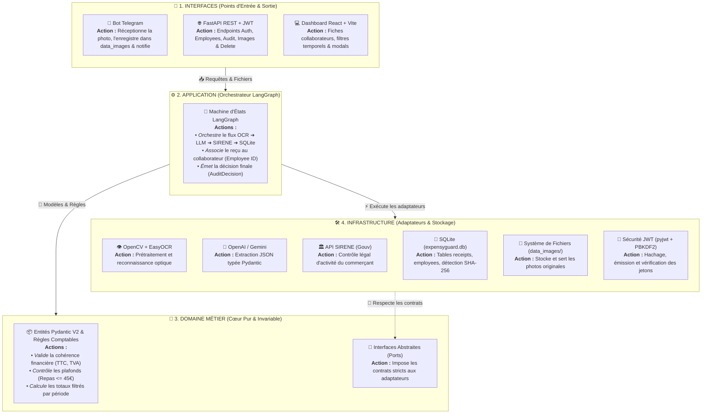

# 🛡️ ExpensyGuard - Audit Automatisé & Gestion des Notes de Frais

[](https://www.python.org/)
[](https://vitejs.dev/)
[](https://martinfowler.com/bliki/HexagonalArchitecture.html)
[](https://github.com/langchain-ai/langgraph)
[](https://jwt.io/)
[](https://docs.pytest.org/)

**ExpensyGuard** est une plateforme complète et intelligente d'audit et de gestion des notes de frais d'entreprise. Elle permet aux collaborateurs d'envoyer des photos de tickets (via smartphone/Telegram ou Dashboard Web), applique un prétraitement optique (OpenCV/EasyOCR), extrait les données financières par IA, valide la légalité du commerçant (API SIRENE), bloque les doublons (SHA-256), gère les fiches collaborateurs avec filtres temporels dynamiques, et sécurise l'administration grâce à l'authentification JWT avec contrôle de rôles (RBAC).

---

## 🌟 Fonctionnalités Clés

- 🔐 **Authentification JWT & Rôles (RBAC)** :
  - **`admin`** : Supervision globale, consultation de tous les audits, filtrage des fiches collaborateurs, et **suppression sécurisée** des tickets (en BDD SQLite et suppression physique de l'image disque).
  - **`user`** : Consultation des audits, soumission de nouveaux reçus, exploration des fiches collaborateurs (actions destructives verrouillées).
- 👥 **Gestion des Collaborateurs & Fiche Employé Interactive** :
  - Table `employees` (Alexandre Martin, Sophie Durand, Thomas Leroy, Élodie Petit...).
  - **Fiche Collaborateur Modal** avec filtres temporels dynamiques : **Jour (`YYYY-MM-DD`)**, **Mois (`YYYY-MM`)**, **Année (`YYYY`)**, ou **Tout**.
  - Recalcul en temps réel du total des dépenses validées (€) et du taux de conformité par période.
- 🖼️ **Stockage & Visualisation des Images Réelles (`data_images/`)** :
  - Conservation automatique de l'image brute originale envoyée via Telegram ou l'API Web.
  - Visualisation instantanée de l'image haute définition dans une modal dédiée sur le Dashboard.
- 💰 **Calcul Strict des Dépenses Réelles** :
  - Seuls les tickets validés (`status = 'APPROVED'`) sont comptabilisés dans le total des dépenses de l'entreprise et des collaborateurs.
- 🤖 **Pipeline d'Audit par IA (LangGraph + OpenAI/Gemini)** :
  - OCR avec binarisation adaptative OpenCV + EasyOCR.
  - Extraction structurée typée Pydantic V2.
  - Validation légale via l'API Registre SIRENE (recherche-entreprises.api.gouv.fr).
  - Détection cryptographique des doublons par hachage SHA-256.

---

## 🏛️ Architecture Hexagonale avec Rôles & Flux



---

## 📁 Arborescence Complète du Projet

```text
expensyguard/
├── .env.example              # Gabarit des variables de configuration
├── README.md                 # Documentation générale du projet
├── plan_projet.md            # Blueprint technique et spécifications
├── Etap_Fonctionnement.md    # Déroulé séquentiel pas-à-pas des 7 étapes
├── connexion_to_bot.md       # Guide de l'intégration Telegram & streaming image
├── pyproject.toml            # Gestionnaire de dépendances Python (uv)
├── data_images/              # 🖼️ Dossier de stockage des photos réelles de tickets
│   └── (images brutes .jpg / .png sauvegardées)
├── frontend/                 # 💻 Application Web Dashboard (React 19 + Vite)
│   ├── package.json
│   ├── vite.config.js
│   └── src/
│       ├── App.jsx           # Dashboard complet (Auth, Fiches employés, Modals, Filtres)
│       ├── index.css         # Design system moderne (Thème Dark / Glassmorphism)
│       └── main.jsx
├── src/
│   ├── domain/               # 💎 Cœur Métier Pur (Sans dépendance externe)
│   │   ├── models.py         # Entités Pydantic V2 (Receipt, Employee, AuditDecision, Status)
│   │   └── ports.py          # Interfaces abstraites (OCR, LLM, Registre, DB, Auth)
│   ├── infrastructure/       # 🛠️ Adaptateurs Techniques (I/O, APIs, BDD, Sécurité)
│   │   ├── ocr_adapter.py    # OpenCV + EasyOCR
│   │   ├── llm_adapter.py    # OpenAI / Gemini Structured Outputs
│   │   ├── registry_api.py   # Client HTTP asynchrone API SIRENE
│   │   ├── db_repository.py  # SQLite (tables receipts & employees, filtres temporels, SHA-256)
│   │   └── security.py       # Hachage PBKDF2 & gestion des jetons JWT (pyjwt)
│   ├── application/          # ⚙️ Orchestration des Cas d'Usage
│   │   ├── state.py          # État partagé du graphe (AuditFlowState)
│   │   ├── nodes.py          # Nœuds atomiques du pipeline LangGraph
│   │   └── graph.py          # Compilation du StateGraph LangGraph
│   └── interfaces/           # 🚪 Points d'Entrée Utilisateurs
│       ├── telegram_bot.py   # Bot Telegram (Long-polling + Enregistrement photo brute)
│       ├── cli.py            # Commande CLI locale
│       └── api/              # API REST FastAPI sécurisée
│           └── main.py       # Endpoints Auth, Employees, Audit, Images & Delete
└── tests/
    ├── unit/                 # Tests unitaires des modèles et des règles de gestion
    │   └── test_domain_models.py
    └── integration/          # Tests d'intégration du pipeline LangGraph complet
        └── test_full_pipeline.py
```

---

## 🔑 Identifiants & Comptes de Démonstration

L'application inclut un système d'authentification JWT avec 2 rôles préconfigurés :

| Rôle | Nom d'utilisateur | Mot de passe | Privilèges |
| :--- | :--- | :--- | :--- |
| 🛡️ **Admin** | `admin` | `admin123` | **Accès total** : Consultation, fiches employés, audit, et **suppression définitive** des tickets en base SQLite et sur disque (`data_images/`). |
| 👤 **User** | `user` | `user123` | **Consultation & Dépôt** : Consultation des audits, soumission de nouveaux reçus, exploration des fiches collaborateurs (actions destructives verrouillées). |

---

## 🌐 Endpoints Principaux de l'API FastAPI

| Méthode | Endpoint | Authentification / Rôle | Description |
| :--- | :--- | :--- | :--- |
| `POST` | `/api/v1/auth/login` | Public | Authentification et émission du jeton JWT Bearer |
| `GET` | `/api/v1/auth/me` | Requis (`user` / `admin`) | Informations sur l'utilisateur connecté |
| `GET` | `/api/v1/employees` | Public | Liste de tous les collaborateurs enregistrés |
| `GET` | `/api/v1/employees/{id}` | Public (Query params : `period_type`, `date_value`) | **Fiche Collaborateur** complète avec totaux recalculés selon le filtre temporel |
| `GET` | `/api/v1/receipts` | Public | Liste de tous les tickets audités avec détails collaborateurs |
| `GET` | `/api/v1/receipts/{id}/image` | Public | Stream de l'image réelle depuis le dossier `data_images/` |
| `POST` | `/api/v1/audit` | Public | Soumission d'une photo de ticket avec rattachement collaborateur |
| `DELETE` | `/api/v1/receipts/{id}` | 🛡️ **Admin Requis** | **Suppression définitive** du ticket en base et sur le disque |

---

## 🚀 Guide de Démarrage Rapide

### 1. Installation des dépendances Backend
```bash
uv sync
```

### 2. Configuration des Variables d'Environnement (`.env`)
```bash
cp .env.example .env
```
*Renseignez vos clés `LLM_API_KEY`, `TELEGRAM_BOT_TOKEN`, et `JWT_SECRET_KEY`.*

### 3. Lancer l'API REST FastAPI
```bash
uv run uvicorn src.interfaces.api.main:app --reload --host 0.0.0.0 --port 8000
```
> *Documentation Swagger interactive : `http://localhost:8000/docs`*

### 4. Lancer le Dashboard Frontend React (Vite)
```bash
cd frontend
npm install
npm run dev
```
> *Dashboard accessible sur : `http://localhost:5173`*

### 5. Lancer le Bot Telegram (Optionnel)
```bash
uv run python -m src.interfaces.telegram_bot
```

### 6. Exécuter la Suite de Tests
```bash
uv run pytest -v
```
