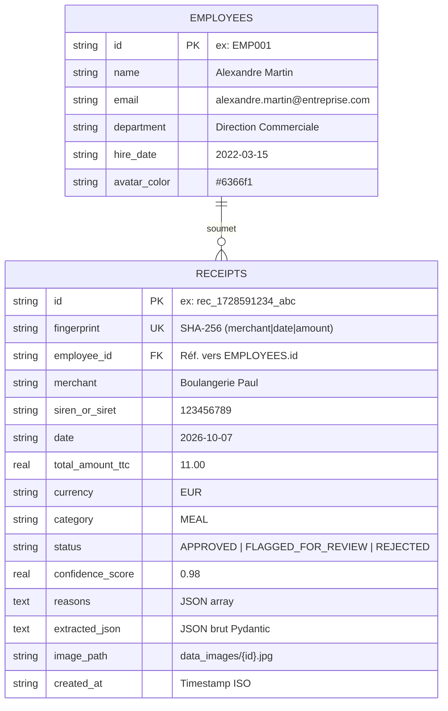

# Blueprint Technique : ExpensyGuard (Audit Automatisé de Reçus & Gestion RH/Comptable)

## 1. Contexte & Objectif du Projet
Construire un système d'audit automatique et de gestion des notes de frais fiscaux en **Clean Architecture (Hexagonale)**.
Le système reçoit une image/PDF de reçu de caisse, applique un prétraitement et un OCR, utilise un LLM pour extraire les données au format JSON structuré et typé, valide l'existence légale du commerçant via une API publique de registre (SIRENE), bloque les doublons en base SQL, sauvegarde l'image brute originale dans `data_images/`, associe chaque reçu à un collaborateur (`employees`), calcule les statistiques filtrées par période (Jour, Mois, Année, Tout), et sécurise l'administration avec **JWT** et contrôle d'accès basé sur les rôles (**RBAC : Admin vs User**).

---

## 2. Stack Technique & Dépendances

### Backend
* **Python :** >= 3.11
* **Gestionnaire de dépendances :** `uv`
* **Validation & Typage :** Pydantic V2 (`BaseModel`, `Field`, `model_validator`) + `decimal.Decimal`
* **Sécurité & Authentification :** `pyjwt`, `hashlib` (PBKDF2-HMAC-SHA256)
* **OCR & Vision :** `opencv-python-headless`, `easyocr`, `Pillow`
* **LLM & Extraction :** `openai` (Structured Outputs via `client.beta.chat.completions.parse` compatible OpenAI / Google Gemini)
* **Client Réseau Asynchrone :** `httpx`
* **Orchestration Agentique :** `langgraph`
* **Base de données :** `sqlite3` (fichier persistant `expensyguard.db`)
* **Interface HTTP :** `fastapi`, `uvicorn`, `python-multipart`
* **Tests :** `pytest`, `pytest-asyncio`

### Frontend
* **Framework :** React 19 + Vite
* **Icônes :** Lucide React (`lucide-react`)
* **Design & Styles :** Vanilla CSS moderne avec design tokens, glassmorphism, animations fluides et mode sombre

---

## 3. Schéma Relationnel de Base de Données



---

## 4. Matrice des Rôles & Permissions (RBAC)

| Fonctionnalité | Rôle `user` (Collaborateur) | Rôle `admin` (Gestionnaire / Superviseur) |
| :--- | :---: | :---: |
| Connexion JWT (`POST /api/v1/auth/login`) | ✅ | ✅ |
| Consultation du Dashboard et des Statistiques | ✅ | ✅ |
| Visualisation des images réelles (`data_images/`) | ✅ | ✅ |
| Consultation et filtrage temporel de la Fiche Employé | ✅ | ✅ |
| Soumission d'un nouveau reçu pour audit | ✅ | ✅ |
| **Suppression définitive d'un reçu** (`DELETE /api/v1/receipts/{id}`) | ❌ *(Bouton verrouillé)* | ✅ *(Actif avec confirmation)* |

---

## 5. Arborescence du Projet

```text
expensyguard/
├── .env.example
├── pyproject.toml
├── data_images/              # Stockage des photos originales de reçus
├── frontend/                 # Application Frontend React 19 + Vite
│   ├── package.json
│   ├── vite.config.js
│   └── src/
│       ├── App.jsx           # Composant Dashboard principal
│       ├── index.css         # Styles globaux & tokens CSS
│       └── main.jsx
├── src/
│   ├── domain/
│   │   ├── models.py         # Receipt, Employee, AuditDecision, Status
│   │   └── ports.py          # Interfaces abstraites (OCR, LLM, Registre, DB, Auth)
│   ├── infrastructure/
│   │   ├── ocr_adapter.py    # Prétraitement OpenCV + EasyOCR
│   │   ├── llm_adapter.py    # Structured Outputs OpenAI / Gemini
│   │   ├── registry_api.py   # Client httpx asynchrone API SIRENE
│   │   ├── db_repository.py  # SQLite (tables receipts & employees, filtres temporels)
│   │   └── security.py       # Hachage PBKDF2 & gestion des jetons JWT
│   ├── application/
│   │   ├── state.py          # TypedDict AuditFlowState pour LangGraph
│   │   ├── nodes.py          # Nœuds atomiques du pipeline
│   │   └── graph.py          # Assemblage StateGraph & compilation
│   └── interfaces/
│       ├── telegram_bot.py   # Bot Telegram avec streaming & enregistrement image
│       ├── cli.py            # Commande CLI locale
│       └── api/
│           └── main.py       # API REST FastAPI sécurisée (Auth, Employees, Receipts, Images)
└── tests/
    ├── unit/
    │   └── test_domain_models.py
    └── integration/
        └── test_full_pipeline.py
```